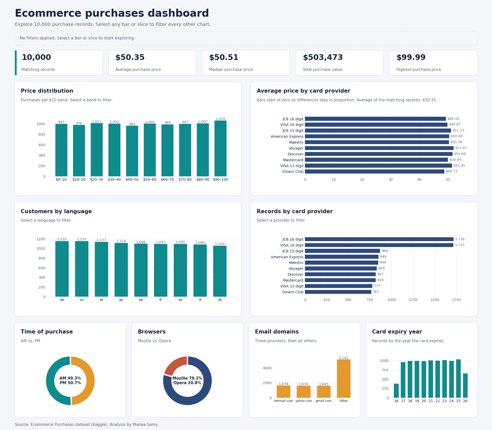

<h1 align="center">🛒 Ecommerce Purchases Analysis</h1>

  Exploratory data analysis of 10,000 online purchase records using Python, with an interactive dashboard

  
  
  
  

  

---

## 📑 Table of Contents

- [Overview](#-overview)
- [At a Glance](#-at-a-glance)
- [Workflow](#-workflow)
- [Key Findings](#-key-findings)
- [Interactive Dashboard](#-interactive-dashboard)
- [Repository Structure](#-repository-structure)
- [How to Run](#-how-to-run)
- [Data Note](#-data-note)
- [Next Steps](#-next-steps)
- [Author](#-author)

---

## 📌 Overview

This project explores the **Ecommerce Purchases** dataset from Kaggle. It cleans the data, answers 12 questions with Pandas, visualizes the results with Matplotlib and Seaborn, and turns the findings into an interactive dashboard.

---

## ⚡ At a Glance

| 🧾 Records | 🏷️ Avg. Purchase | 💰 Price Range | 🕐 AM / PM Split |
|:---:|:---:|:---:|:---:|
| **10,000** | **≈ $50.35** | **$0.00 – $99.99** | **4,932 / 5,068** |

---

## 🔄 Workflow

1. **Load & Inspect** – Reviewed the first and last rows, data types, and shape (`head()`, `tail()`, `dtypes`, `info()`).
2. **Clean** – Dropped `Address`, `Lot`, `CC Security Code`, and `IP Address`. Checked for missing values and duplicates: **none found**.
3. **Analyze** – Used filtering, `value_counts()`, and string operations to answer 12 questions.
4. **Visualize** – Built count plots and a bar chart with Seaborn.
5. **Dashboard** – Built an interactive HTML dashboard from the cleaned data.

> **Final dataset:** 10,000 rows × 10 columns  
> `AM or PM` · `Browser Info` · `Company` · `Credit Card` · `CC Exp Date` · `CC Provider` · `Email` · `Job` · `Language` · `Purchase Price`

---

## 🔍 Key Findings

| # | Question | Result |
|:---:|---|---|
| 1 | Average purchase price | **≈ $50.35** (median $50.51) |
| 2 | Highest purchase price | **$99.99** (*Surveyor, hydrographic* and *Surveyor, insurance*) |
| 3 | Lowest purchase price | **$0.00** (*Biomedical scientist* and *Stage manager*) |
| 4 | Customers with French (`fr`) as language | **1,097** |
| 5 | Most common languages | German and Russian tie at **1,155**; Chinese is lowest at 1,059 |
| 6 | Job titles containing "engineer" | **984** |
| 7 | Mastercard users with purchases above $50 | **405** |
| 8 | Top credit card providers | **JCB 16 digit (1,716)** and **VISA 16 digit (1,715)** |
| 9 | Purchases in AM vs. PM | **PM: 5,068** · **AM: 4,932** |
| 10 | Cards expiring in 2020 | **988** |
| 11 | Top email domains | hotmail.com (1,638) · yahoo.com (1,616) · gmail.com (1,605) |
| 12 | Top browsers | **Mozilla (7,924)** · **Opera (2,076)** |

**Observations**
- Prices are spread almost evenly between $0 and $100: each $10 band holds about 10% of purchases.
- Average price barely changes between card providers ($48.73 to $51.97), languages, or browsers. These gaps are small compared with the standard deviation of about $29.
- Average price per job is unreliable for jobs with few purchases, so compare jobs only above a minimum count.

## 👩‍💻 Author

**Marwa Samy** · [GitHub](https://github.com/marwa23-rgb)
